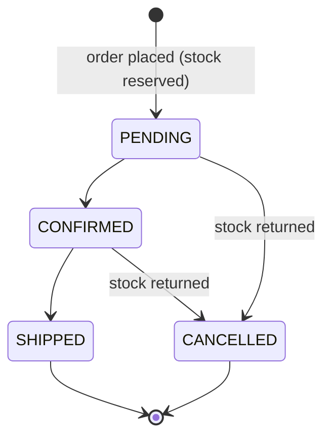

# Inventory & Order API

[](https://github.com/ryan-mendes/inventory-order-api/actions/workflows/ci.yml)


REST API for inventory and sales order management, modeled on the core flows of an ERP back office: product catalog, stock receipts and adjustments, order placement with stock reservation, and an order lifecycle with enforced transitions.

The focus is on business-rule correctness: stock can never go negative, multi-item orders are all-or-nothing, and every stock change is written to an auditable ledger that always reconciles with on-hand quantities.

## Business rules

| Rule | Behavior |
|---|---|
| Stock integrity | Stock never drops below zero. Requests that would do so fail with `422`. |
| Atomic orders | An order reserves stock for all items in one transaction. If any item is short, nothing is reserved. |
| Price capture | Unit prices are stored on the order at creation time. Later catalog changes do not alter existing orders. |
| Order workflow | `PENDING → CONFIRMED → SHIPPED`. `PENDING` and `CONFIRMED` orders can be cancelled. `SHIPPED` and `CANCELLED` are final. |
| Stock return | Cancelling an order returns its reserved quantities to stock. |
| Audit trail | Every stock change (`RECEIPT`, `ADJUSTMENT`, `ORDER_RESERVED`, `ORDER_CANCELLED`) is recorded with a reference. |



## Tech stack

- **Runtime:** Node.js 24, TypeScript in strict mode
- **HTTP:** Express
- **Validation:** Zod schemas at the edge, with consistent error payloads
- **Persistence:** SQLite through the built-in `node:sqlite` module, with no ORM or native build step
- **Testing:** Vitest + Supertest integration tests against an in-memory database
- **Delivery:** GitHub Actions CI, multi-stage Docker image

## Architecture

```
src/
├── app.ts                  # Composition root: wires services and routes
├── server.ts               # HTTP entry point
├── shared/
│   ├── database.ts         # Schema, connection, transaction helper
│   ├── errors.ts           # AppError hierarchy + error middleware
│   └── pagination.ts
└── modules/
    ├── products/           # Catalog: schema, service, routes
    ├── stock/              # Stock movements and ledger
    └── orders/             # Orders, workflow and stock reservation
```

Each module separates **routes** (HTTP and validation), **services** (business rules) and **schemas** (input contracts and types). Services receive their dependencies through the constructor, which keeps them easy to test and to swap.

## Getting started

```bash
npm install
npm run dev          # http://localhost:3000, persists to ./data.db
npm test             # 14 integration tests
npm run build && npm start
```

With Docker:

```bash
docker build -t inventory-order-api .
docker run -p 3000:3000 -v inventory-data:/data inventory-order-api
```

| Variable | Default | Description |
|---|---|---|
| `PORT` | `3000` | HTTP port |
| `DATABASE_PATH` | `data.db` | SQLite file (`:memory:` for ephemeral) |

## API reference

### Products

| Method | Route | Description |
|---|---|---|
| `POST` | `/products` | Create a product |
| `GET` | `/products?page=&pageSize=&search=` | List products (paginated, searchable by name or SKU) |
| `GET` | `/products/:id` | Get a product |
| `PATCH` | `/products/:id` | Update name or price |

### Stock

| Method | Route | Description |
|---|---|---|
| `POST` | `/products/:id/stock` | Record a `RECEIPT` or `ADJUSTMENT` |
| `GET` | `/products/:id/stock` | Stock ledger, newest first |

### Orders

| Method | Route | Description |
|---|---|---|
| `POST` | `/orders` | Place an order (reserves stock) |
| `GET` | `/orders?status=&page=&pageSize=` | List orders |
| `GET` | `/orders/:id` | Get an order with its items |
| `PATCH` | `/orders/:id/status` | Move an order through the workflow |

### Example

```bash
# Create a product and receive stock
curl -X POST localhost:3000/products -H 'Content-Type: application/json' \
  -d '{"sku":"KB-001","name":"Mechanical keyboard","priceCents":15000}'

curl -X POST localhost:3000/products/1/stock -H 'Content-Type: application/json' \
  -d '{"quantity":50,"reason":"RECEIPT","reference":"PO-2026-001"}'

# Place an order
curl -X POST localhost:3000/orders -H 'Content-Type: application/json' \
  -d '{"customer":"Acme Ltd","items":[{"productId":1,"quantity":3}]}'
```

### Errors

All errors share one shape:

```json
{ "error": { "code": "BUSINESS_RULE_VIOLATION", "message": "Insufficient stock for product 1: available 2, requested 3" } }
```

| Status | Code | When |
|---|---|---|
| 400 | `VALIDATION_ERROR` | Invalid body or query (includes per-field `details`) |
| 404 | `NOT_FOUND` | Unknown resource |
| 409 | `CONFLICT` | Duplicate SKU |
| 422 | `BUSINESS_RULE_VIOLATION` | Insufficient stock or invalid status transition |

## License

MIT
